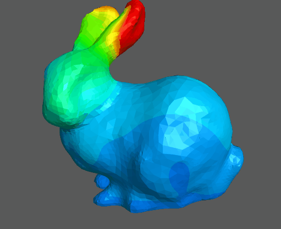
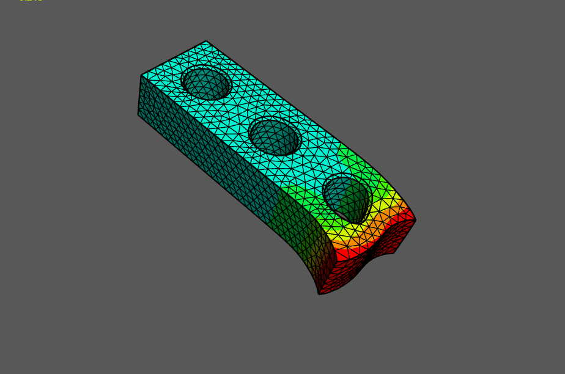
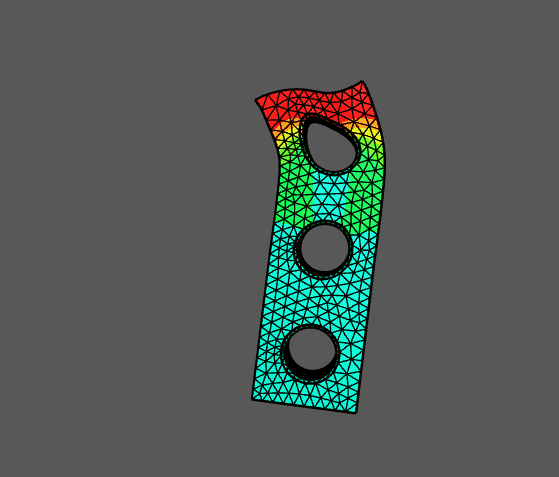

# Elastodynamics
The goal of this project is to simulate soft bodies using non linear elastodynamics of hyperelastic materials.

Full Documentation is found in [PDF](Elastodynamics.pdf)

## Target Geometries

Starting with simple bar deformation as test. The endgoal is to import 3D objects like the [Stanford Bunny](https://graphics.stanford.edu/data/3Dscanrep/) as deformation test subjects.

## Target equation

$$
\rho \frac{\partial^2 \bm{u}}{\partial t^2} - \frac{\partial \bm{c}}{\partial t} + \nabla \bm{P} + \bm{F} = 0
$$

Where:
- $\rho$ is the material density (mass per unit volume in the reference configuration),
- $\mathbf{u}$ is the displacement field,
- $\frac{\partial^2 \mathbf{u}}{\partial t^2}$ is the acceleration,
- $\mathbf{f}_{\text{ext}}$ represents external forces applied to the body.
- $\sigma$ represents the Cauchy stress tensor:
$$ \sigma = C : \epsilon $$
- $c = \eta \epsilon$ is a term to model viscoelastic damping

More infos are in the [documentation PDF](Elastodynamics.pdf)
## Files
Easy to run files are:
- [Elastostatics](Static_Brick.ipynb)
- [Undampened Elastodynamics Test](Timestepping_Brick.ipynb)
- [Dampened Elastodynamics Test](Timestepping_Dampened.ipynb) 

These need large amounts of RAM: 
- [Takoma Narrows Simulation](bridge_without_damping)
- [Bunny Simulation](Bunny_Simulation.ipynb) (min 42GB)

## Results
 
 

